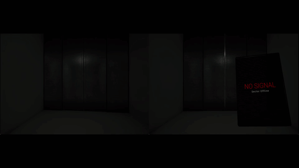

# Clockbait

A two-player asymmetric co-op horror game in Unreal Engine 5.6. Two players stand in geometrically identical rooms they cannot see each other in. One is locked in the dark with a flashlight and a puzzle; the other has the lights on, a tablet, and the only view of what is hunting their partner. Neither can finish alone — the clues are split so that solving the puzzle requires describing it out loud.

Each room has its own **Clockhead**: a grandfather clock on legs that patrols, investigates noises, and runs to silence alarms. It is too tall to fit through the doors, so it never leaves.

> C++-first gameplay code with Blueprint used for presentation only. Built solo as a vertical slice.

---

## Status

Vertical slice. One full segment plays start to finish: enter → dark room → split clues → confirm the solution → lights, alarms silenced, entity frozen, doors open → escape. Wrong answers are punished; being caught is fatal.

[](https://youtu.be/sPf_TldHyhc)

*(Click through for the full vertical slice video.)*

---

## What is interesting in here

### Replication model

The rule the codebase follows throughout: **one-shot events are pushed as RPCs, continuous values are replicated as properties.** A `ReplicatedUsing` property gives both the state and the change notification, so a client that joins late or misses a frame still converges; a multicast only reaches whoever happens to be connected and leaves the variable stale behind it.

That distinction shows up most clearly in `AClockbaitRoomVolume`, which owns everything about a room that both machines need to agree on — whether the lights are on, how many attempts the pair has burnt, whether this room's station is solved — each as a replicated property with a notify. The server calls those notify functions manually after writing, because `OnRep` does not fire on the authority.

Derived from that, a second rule: **recompute state rather than toggling it.** The room's indicator lamps are not switched one by one as events arrive. Every replicated change recomputes the whole row from the two values that drive it, so the picture cannot desynchronise regardless of which value arrives first.

### AI

`AClockheadEntity` is its own `ACharacter` subclass owning four states, a speed per state, freezing (brain stopped, timer to restart) and the kill. The behaviour tree only reports what it perceives; the entity decides what that means.

- **`UBTService_UpdatePlayerLocation`** resolves perception into a single state per tick and publishes the entity's position and state to the GameState, which is what feeds the partner's tablet.
- **`UBTService_CatchPlayer`** runs on the root selector and measures distance every tick, with a wider radius against a hidden target — raising the nav agent radius pushed the navmesh far enough from the furniture that the normal one could no longer reach. It uses per-node instance memory (`GetInstanceMemorySize` / `InitializeMemory` / `CleanupMemory`) to carry state between ticks, since behaviour tree nodes are shared per asset rather than per instance.
- AI is scoped per room, so two entities run in one level without seeing each other's players.

### Hiding, and why it stopped asking the NavMesh

Hiding is physical: the player is teleported, frozen, their pitch locked, and they leave in the direction they look. The first implementation asked `ProjectPointToNavigation` whether the exit spot was valid — and two identical chairs in two identical rooms behaved differently.

The NavMesh was never answering that question. Its shape depends on the agent radius, the voxel cell size, and the room's absolute position in the world, because Recast rasterises on a world-aligned grid. The exit now probes outward from the hiding spot itself (the player is under the floor while hidden), stops short of walls by a capsule radius, and finds the ground with a downward trace. It asks about geometry, because geometry was the question.

### The tablet is a sensor, not a map

The rooms share a layout, so "here is a map of your room" carries no information. What the tablet carries is the partner's position and the entity's — colour-coded by AI state, interpolated between updates, and blanked when the room loses power.

The map image is an orthographic capture framed exactly to the room volume's bounds, and every marker is generated at runtime from the level's own data: the room's alarm, hiding-spot and station arrays, each rotated to match the actor it represents. Moving a chair in the editor cannot desynchronise the map from the level, because nothing about the map is drawn by hand.

### The entity's walk

The Clockhead was modelled, rigged and animated for this project. It has no knees, so a human walk cycle retargets badly onto it; the gait is hand-authored on a seven-bone skeleton instead, with every part rigidly skinned to a single bone except one deliberately flexible collar.

With rigid legs, stride length is capped by geometry at `2 · L · sin(θ)`, which ties the animation directly to `MaxWalkSpeed`: the AnimBP sets play rate to `GroundSpeed / AuthoredSpeed`, so stride length stays fixed while cadence scales, and foot sliding is zero at every speed from patrol to chase. The ticking is an AnimNotify on the contact frames, so it accelerates with the creature for free.

---

## Running it

The project is C++ and needs to be built before the editor will open it.

```
Clockbait.uproject  →  right click  →  Generate Visual Studio project files
Build in Visual Studio (Development Editor)
```

For a packaged build, the launcher scripts take a map URL:

```bat
Clockbait.exe /Game/MyStuff/Maps/L_Menu?listen   :: host
Clockbait.exe 127.0.0.1                          :: join
```

Note that **Shipping packages ignore the command-line map URL**, so listen servers currently have to be started from a Development build. Replacing this with a host/join screen inside the game is the next piece of work.

---

## Layout

```
Source/Clockbait/     all gameplay C++
Config/               project settings, including the navigation agent sized for the entity
```

`Content/` is not versioned in this repository.

---

## Known limitations

- No in-game hosting UI; sessions are started from the command line.
- Voice chat is out of scope for the slice — players use an external channel. The intended design is proximity voice between mirrored positions in the two mazes, which is why the layouts are identical.
- Segment progression and room streaming are designed but not built; the slice is one segment.
